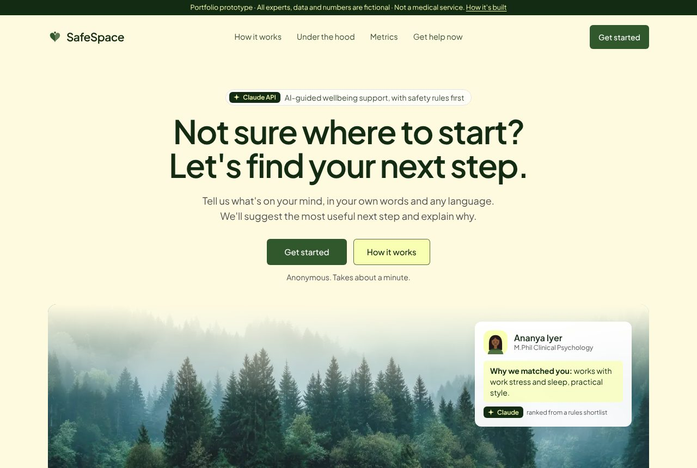
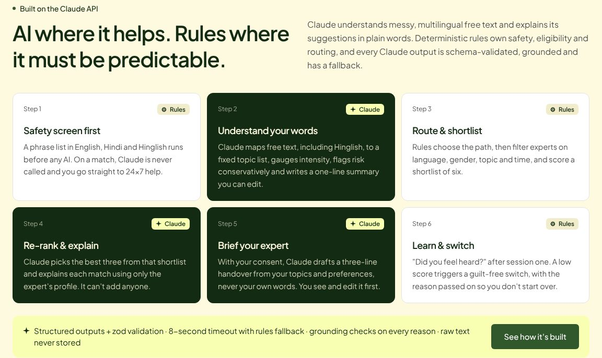

# SafeSpace

**AI-guided mental wellbeing support, built on the Claude API, with safety rules always first.**

**▶ Live demo: [safespace-beta.vercel.app](https://safespace-beta.vercel.app)** · Case study: [/under-the-hood](https://safespace-beta.vercel.app/under-the-hood) · Metrics: [/insights](https://safespace-beta.vercel.app/insights)

Say what's on your mind in your own words, in English, Hindi or Hinglish. SafeSpace works out the most useful next step (talk to the right expert, start with a self-help tool, or get help right now) and explains why.

> **Portfolio prototype.** All experts, bookings and metrics are fictional, storage is in-memory, and it is not a medical service. The crisis numbers it shows (Tele-MANAS 14416, emergency 112) are real Indian helplines.



## Highlights

- **Three Claude features, each with a fallback:**
  - Understanding messy, multilingual free text
  - Re-ranking a rules shortlist of experts, with a grounded reason for each
  - Drafting a consented, editable handover brief for the expert
- **Rules where it must be predictable:** a safety screen runs before any model call, and eligibility and routing are deterministic. Claude can reorder the shortlist but can never add an expert to it.
- **Production-minded LLM engineering:**
  - Structured outputs plus zod validation, with taxonomy and IDs constrained by enums
  - An 8-second timeout and one retry on invalid output
  - Grounding checks run in code, and prompt-injection hygiene
- **Honest UI:** every AI-generated element is tagged "Claude". If a call falls back, it says "Rules fallback" instead.
- **Privacy by design:** no login, names and numbers scrubbed, and the raw free text is never stored.
- **A complete journey:** check-in → "here's what we understood" (editable) → matches → booking with consent → "Did you feel heard?" → guilt-free switch with a handover → metrics dashboard.



## Where AI is used, and where it isn't

| Step | Owner | Code |
|---|---|---|
| Strip names, phones, emails | Rules | `lib/pii.ts` |
| **Safety screen (runs first; skips AI on a match)** | Rules: EN / Hindi / Hinglish phrase list | `lib/safety.ts` |
| Free text → topics, intensity, risk, summary, confidence | **Claude** | `lib/ai.ts` `understand()` → `/api/understand` |
| Choose path (expert / self-help / help now) | Rules | `lib/route.ts` |
| Hard filters + weighted score → shortlist of 6 | Rules | `lib/match.ts` |
| Pick and order the best 3, with grounded reasons | **Claude** (IDs must come from the 6; falls back to the rule top 3) | `lib/ai.ts` `rerank()` → `/api/rerank` |
| 3-line expert brief (consent toggle, shown and editable first) | **Claude** (from tags and preferences only, never raw text) | `lib/ai.ts` `brief()` → `/api/brief` |
| Safety gate on every later AI call | Rules | `lib/guard.ts` |

The full case study is in the app at **`/under-the-hood`**. The metrics dashboard (seeded with ~420 synthetic sessions) is at **`/insights`**.

## Tech stack

Next.js 15 (App Router) · TypeScript · Tailwind CSS v4 · Claude API via the Anthropic TypeScript SDK (`claude-haiku-5-5`) · zod · Recharts · Playwright · Vercel

## Run locally

```bash
npm install
```

```bash
echo "ANTHROPIC_API_KEY=sk-ant-..." > .env.local
```

```bash
npm run dev
```

Without `ANTHROPIC_API_KEY` the app still works end to end in rules-only fallback mode, and the UI labels it as such. An optional Supabase backend is supported (`supabase/schema.sql`, `npm run seed`); without it, storage is in-memory.

**Demo personas:** on `/start`, tick the consent box and open "Try a demo persona":
- **Riya:** student, English
- **Arjun:** engineer, Hinglish
- **Crisis case:** tests the safety layer

**End-to-end smoke test** (all personas, at 375px and 1280px):

```bash
BASE=http://localhost:3000 node scripts/smoke-test.js
```

Deployment notes: [`docs/DEPLOY.md`](docs/DEPLOY.md).

---

Designed and built by **[Neeraj](https://neeraj-portfolio-pm.vercel.app/)**. Experts are shown as illustrated avatars.
